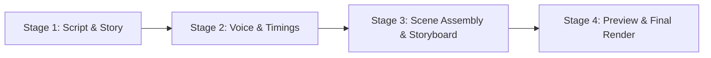

# Kahani Animated Story Studio — Production Rules & Standard Operating Procedures

Welcome to **Kahani**, an animated video production studio built on **Remotion** and **HyperFrames** for crafting cinematic vertical reels (1080×1920 @ 30fps) focused on cultural, mythological, and philosophical folklore stories.

---

## 1. Core Studio Principles & Golden Rules

### Rule 1: Script & Story Bible First
* **No code or animation begins without a complete, locked script.**
* Every story lives in its own dedicated directory under `stories/<story-id>/`.
* The folder must contain:
  1. `script.md`: The complete narrative, voice-over text, scene breakdown, and emotion beats.
  2. `voice.wav` / `voice.mp3`: Recorded or synthesized voice-over narration.
  3. `timings.json`: Word-level timestamps generated via `tools/timings.py`.

### Rule 2: Storyboard Before Any Full Render
* **Never render a full reel blindly.**
* Always block each shot using still frames (`npx remotion still <CompositionId> --frame=<f>`).
* Verify composition layout, contrast, colors, and asset placement across major transitions before rendering the entire timeline.
* Use Remotion Studio (`npm run dev`) or HyperFrames preview for real-time visual inspection and scrubbing.

### Rule 3: Deities & Divine Figures Must Be Portrayed with Calm, Respectful Faces
* Deities (e.g. Shiva, Krishna, Rama, Vishnu, Durga, Ganesha, Hanuman) and enlightened sages must **always** be drawn with calm, serene, dignified, and compassionate expressions (`eyeExpression="calm"`, gentle gentle smile).
* **Never** depict divine characters with exaggerated comical slapstick, mock anger, or distorted facial caricatures.
* Sacred icons, vahanas, tilaks, and traditional attire (dhotis, mukuts, garlands, pitambara) must adhere to reverent classical iconography.

### Rule 4: Strict Title-Safe & Safe-Zone Rules for Vertical Reels
* The canvas is **1080 × 1920 (9:16 vertical)**.
* Key text, kinetic captions, and critical facial action **MUST** stay inside the **80% Title Safe Area**:
  - **Top Margin**: Keep at least **150px** clear of top handles and reels header overlays.
  - **Bottom Margin**: Keep at least **320px** clear of reel captions, audio metadata, and bottom navigation tabs.
  - **Side Margins**: Keep at least **80px** margin on left and right borders.
* Never place primary text or faces at the extreme edges where mobile platform UI overlays obscure them.

---

## 2. Directory Structure

```text
kahani/
├── stories/                 # Story packages (one folder per narrative)
│   └── story-01-the-journey/
│       ├── script.md        # Scene descriptions, voiceover lines, cue sheets
│       ├── voice.mp3        # Master voice-over narration track
│       └── timings.json     # Word-by-word timing data
├── voice/                   # Raw voiceover takes & speech synthesis assets
├── music/                   # Royalty-free traditional / cinematic background scores (tanpura, flutes, strings)
├── sfx/                     # Ambient sounds & foley (chimes, temple bells, wind, footsteps)
├── out/                     # Final exported reels (.mp4, stills, previews)
├── tools/                   # Automation scripts (timings.py, asset processors)
├── src/                     # Remotion source code
│   ├── components/          # Reusable rigs & scene elements
│   │   ├── CharacterRig.tsx # Modular SVG character with walk/wave/blink/breathe
│   │   └── scene/           # Environmental components (Sky, Hills, Diyas, Petals...)
│   ├── Composition.tsx      # Composition definitions
│   └── Root.tsx             # Main Remotion Root
└── RULES.md                 # Studio governance (this file)
```

---

## 3. Production Pipeline (Four-Stage Flow)



### Stage 1: Writing & Planning
1. Create `stories/<story-id>/script.md`.
2. Break down the story into visual scenes with designated durations in seconds.
3. Define character moods, color palettes, and background themes (dawn, golden hour, twilight, midnight).

### Stage 2: Audio & Timings
1. Place voiceover audio into `voice/<story-id>.mp3` or `stories/<story-id>/voice.mp3`.
2. Extract precise word timings with:
   ```bash
   python tools/timings.py stories/<story-id>/voice.mp3 -o stories/<story-id>/timings.json
   ```
3. Place ambient background music in `music/` and foley effects in `sfx/`.

### Stage 3: Scene Assembly
1. Use `<CharacterRig />` with appropriate character styling props (skin tone, clothing type, crown/mukut, accessories).
2. Layer environmental elements:
   - Deep background: `<Sky />` with Sun/Moon & twinkling stars.
   - Parallax midground: `<Clouds />`, `<Hills />` (3 distinct depth layers), and ancient `<Trees />`.
   - Foreground: `<Diyas />` casting warm radial light, with floating divine `<SparksAndPetals />`.
3. Align scene cuts with voiceover timestamps from `timings.json`.

### Stage 4: Review & Render
1. Preview locally with `npm run dev` in browser.
2. Render frame stills at key turning points to inspect safe zones.
3. Export final 1080×1920 MP4:
   ```bash
   npx remotion render <StoryCompositionId> out/<story-id>.mp4
   ```

---

## 4. Reusable Component Standards

* **Component Driven**: All animation parameters must be derived deterministically from `useCurrentFrame()` and `useVideoConfig()`.
* **No External Randomness**: Never call unseeded `Math.random()` inside render cycles; use frame-deterministic math or fixed seeds.
* **Vector Quality**: Use SVG vectors for characters and nature layers so every visual scales crisply across all display resolutions.

